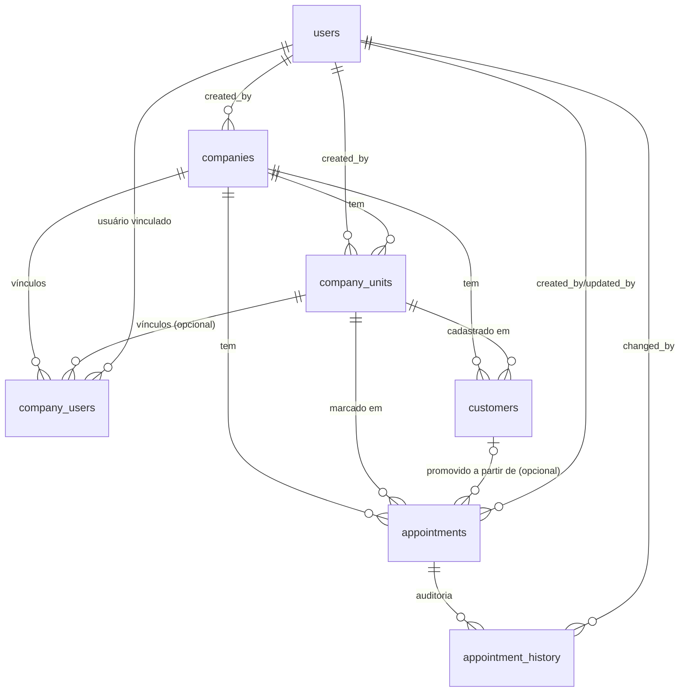

# Arquitetura — Ótica Lab API (NestJS)

Documentação completa da arquitetura: stack, camadas modulares, modelo de domínio, autenticação/autorização, banco de dados, tratamento de erros, escalabilidade, testes e fluxo de trabalho.

## Sumário

- [Visão geral](#visão-geral)
- [Stack tecnológica](#stack-tecnológica)
- [Arquitetura modular (NestJS)](#arquitetura-modular-nestjs)
- [Estrutura de pastas](#estrutura-de-pastas)
- [Modelo de domínio](#modelo-de-domínio)
- [Autenticação e autorização](#autenticação-e-autorização)
- [Banco de dados](#banco-de-dados)
- [Tratamento de erros](#tratamento-de-erros)
- [Escalabilidade](#escalabilidade)
- [Testes](#testes)
- [Referência de endpoints](#referência-de-endpoints)
- [Documentação interativa](#documentação-interativa)

---

## Visão geral

Sistema multi-tenant para clínicas/óticas com múltiplas empresas (`companies`) e unidades (`company_units`). Um agendamento (`appointments`) é criado direto numa unidade, com os dados de quem marcou (nome, telefone) guardados nele mesmo — como **lead**, sem linha em `customers`. Só quando o agendamento é marcado `attended` (compareceu) é que o lead vira de fato um cliente.

```
company (empresa)
  └── company_unit (unidade/filial)
        ├── appointment (agendamento — empresa/unidade próprias, cliente opcional)
        └── customer (cliente, só passa a existir a partir de um appointment attended)
```

O acesso de um usuário a uma empresa/unidade é controlado por vínculos em `company_users`, exceto para `super_admin`, que tem acesso global irrestrito sem precisar de vínculo explícito.

## Stack tecnológica

| Camada | Escolha | Por quê |
|---|---|---|
| Framework HTTP | NestJS | Arquitetura corporativa opinionada, modular, injeção de dependência e ecossistema nativo TypeScript |
| Validação/serialização | `class-validator` + `class-transformer` | Validação declarativa via decorators e tipagem forte em DTOs |
| Documentação API | `@nestjs/swagger` | OpenAPI/Swagger gerado automaticamente e interativo em `/docs` |
| Persistência | Supabase self-hosted (PostgREST) via `@supabase/supabase-js` | API REST de alto desempenho sobre PostgreSQL |
| Autenticação | Passport JWT (`@nestjs/passport`, `passport-jwt`) + `bcryptjs` | Autenticação stateless, rate limit e timing-safe hashing |
| Testes | Vitest | Execução ultrarrápida nativa TypeScript/ESM e compatibilidade total |
| Container | Docker multi-stage | Imagem Alpine mínima para Node.js, com usuário seguro non-root |

## Arquitetura modular (NestJS)

Cada feature é organizada como um módulo NestJS isolado seguindo o padrão Controller-Service-Repository:

```
HTTP Request → Controller → Service → Repository → Supabase (PostgREST) → PostgreSQL
```

| Camada | Responsabilidade |
|---|---|
| **Controller** | Mapeamento de rotas, decorators Swagger, validação via pipes, autorização via guards |
| **Service** | Regras de negócio, autorização multi-tenant, orquestração e casos de uso |
| **Repository** | Encapsulamento de chamadas PostgREST e tradução de erros de banco em exceções de domínio |
| **Entity** | Representação tipada da linha do banco de dados |
| **DTO** | Contrato de entrada/saída tipado com regras de validação |
| **Module** | Declaração e amarração de injeção de dependência |

## Estrutura de pastas

```
src/
├── main.ts                    # Bootstrap do NestJS (Pipes, Filters, Swagger, CORS)
├── app.module.ts              # Módulo orquestrador raiz
├── config/
│   └── app.config.ts          # Configurações tipadas do ambiente (.env)
├── core/
│   ├── database/              # SupabaseService singleton injetável
│   └── security/              # SecurityService (bcrypt timing-safe)
├── common/
│   ├── dto/                   # DTOs compartilhados (PaginationParamsDto, PageDto)
│   ├── enums/                 # UserRole, AppointmentStatus
│   ├── filters/               # AllExceptionsFilter (Postgres/HTTP error handling)
│   └── utils/                 # formatTitleCase e utilitários de texto
└── modules/
    ├── health/                # GET /health
    ├── auth/                  # Login, JWT, Rate Limiting, CurrentUser e RolesGuard
    ├── users/                 # Usuários do sistema e escopo por permissão
    ├── companies/             # Empresas, Unidades e Vínculos de Acesso
    ├── customers/             # Clientes e resolução de escopo
    └── appointments/          # Agendamentos, histórico imutável (RPC) e promoção de lead
```

## Modelo de domínio



## Autenticação e autorização

- **Login**: `POST /auth/login` retorna JWT stateless (expira em 24h).
- **Proteção por papel**: `@Roles(UserRole.SUPER_ADMIN, ...)` combinado com `RolesGuard`.
- **Auto-preenchimento e resolução de escopo**: `CompanyUserService.resolveCompanyAndUnit()` e `resolveScopeForList()`.

## Testes

```bash
# Executa todos os testes unitários
npm test

# Compila o projeto em modo de produção
npm run build
```
